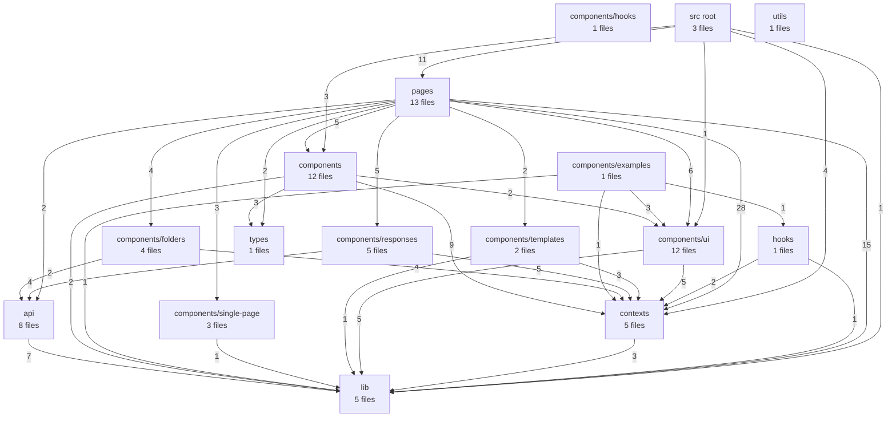
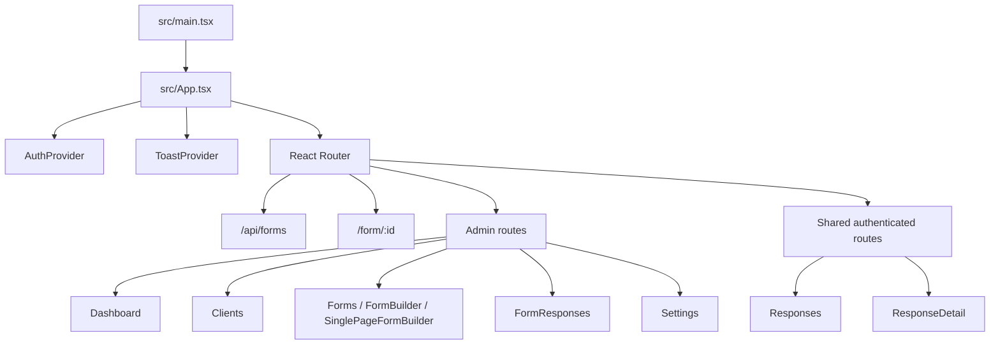

# Repository Graph

Generated by `node tools/graphify.mjs`.

## Source Module Graph

## Runtime Route Graph

## Source Areas

| Area | Files |
| --- | ---: |
| api | 8 |
| components | 12 |
| components/examples | 1 |
| components/folders | 4 |
| components/hooks | 1 |
| components/responses | 5 |
| components/single-page | 3 |
| components/templates | 2 |
| components/ui | 12 |
| contexts | 5 |
| hooks | 1 |
| lib | 5 |
| pages | 13 |
| src root | 3 |
| types | 1 |
| utils | 1 |

## Strongest Internal Links

| From | To | Imports |
| --- | --- | ---: |
| pages | contexts | 28 |
| pages | lib | 15 |
| src root | pages | 11 |
| components | contexts | 9 |
| api | lib | 7 |
| pages | components/ui | 6 |
| components/responses | contexts | 5 |
| components/ui | contexts | 5 |
| components/ui | lib | 5 |
| pages | components | 5 |
| pages | components/responses | 5 |
| components/folders | contexts | 4 |
